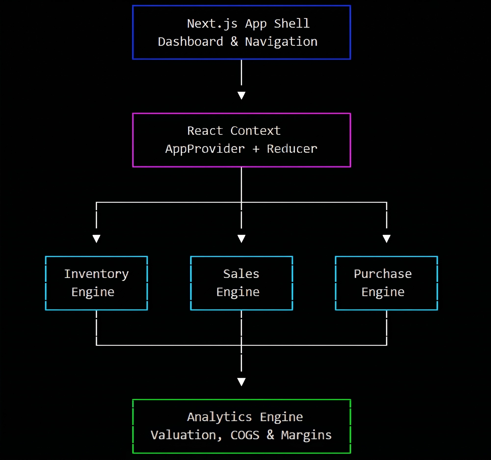

📦 StockFlow
Enterprise Inventory & Supply Chain Management ERP

  <strong>A connected business operations platform for modern inventory, procurement, sales, and warehouse management.</strong>

  
  
  
  
  
  
  

🚀 Overview
StockFlow is an enterprise-oriented Inventory and Supply Chain Management ERP designed to simplify and connect essential business operations.

Built with Next.js 14, React 18, TypeScript, and Tailwind CSS, StockFlow brings inventory, sales, procurement, warehouses, workforce management, and business analytics into one unified operational interface.

Unlike disconnected inventory tools, StockFlow implements interconnected business workflows where important transactions produce corresponding inventory movements, audit records, and updated business metrics.
What makes StockFlow different?
- Connected Operations: Sales, purchases, inventory, and analytics work together through shared business engines.
- Multi-Warehouse Management: Manage inventory across multiple warehouse facilities.
- Transaction Integrity: Maintain a stock movement history with transaction reversals.
- Role-Based Experiences: Three distinct operational dashboards for administrators, managers, and employees.
- Business Intelligence: Track inventory valuation, COGS, gross profit, and operational performance.
- Zero-Setup Demo: Explore realistic Indian enterprise seed data without configuring external infrastructure.
✨ Key Features
Feature	Description
Executive Dashboard	Business KPIs, revenue, valuation, profit margins, and analytics
Inventory Management	SKU catalog, barcode lookup, stock adjustments, and movement history
Sales Management	Sales orders, GST calculations, billing, and fulfillment
Procurement	Purchase orders, receiving inspections, and supplier management
Warehouse Management	Multiple facilities, capacity tracking, and utilization
Business Contacts	B2B customer and supplier management
Workforce Management	Employee directory, designations, and role assignment
Analytics & Reports	Inventory valuation, sales performance, and purchase expenditure
Activity Monitoring	Centralized operational audit history
RBAC	Role-based navigation and permission-aware interfaces

🏗️ System Architecture
StockFlow follows a domain-oriented architecture that separates presentation, application state, and business transaction logic.

  
  

Architectural Principles
1. Domain-Driven Business Engines
Business logic is separated into independent domain engines.
- inventory-engine.ts — Product creation, stock movements, stock adjustments, and threshold detection.
- sales-engine.ts — Sales order validation, GST calculations, fulfillment, and stock deduction.
- purchase-engine.ts — Procurement lifecycle, receiving operations, and inventory increments.
- analytics-engine.ts — Financial calculations, inventory valuation, and business metrics.
- master-data-engine.ts — Validation of employees, customers, suppliers, and warehouse relationships.
2. Stock Movement Ledger
Every stock-changing transaction generates a corresponding movement record.
Movement	Purpose
OPENING	Initial inventory
PURCHASE	Received supplier inventory
SALE	Confirmed customer sales
ADJUSTMENT	Manual inventory correction
SALE_REVERSAL	Restore inventory after sale cancellation
PURCHASE_REVERSAL	Reverse previously received inventory

This ensures that stock changes have an associated transaction history rather than silently overwriting inventory quantities.
3. Centralized State Management
StockFlow uses React Context and useReducer to maintain application state.

Key capabilities:
- Deterministic state transitions.
- Centralized business actions.
- LocalStorage persistence.
- SSR hydration safeguards.
- Demo data restoration.
👥 Role-Based Access Control
StockFlow provides three distinct role-based operational experiences.
Role	Demo Persona	Primary Responsibility
Administrator	Rajesh Sharma	Enterprise oversight
Manager	Priya Sundaram	Warehouse operations
Employee	Amit Patel	Daily operational activities

Administrator
- Enterprise-wide dashboard visibility.
- Inventory valuation and financial metrics.
- Warehouse commissioning and management.
- Employee and role administration.
- Transaction reversals.
- System-wide activity monitoring.
Manager
- Warehouse inventory management.
- Purchase order receiving.
- Sales fulfillment.
- Stock adjustments.
- Customer and supplier management.
- Departmental operational analytics.
Employee
- Product and SKU lookup.
- Sales order drafting.
- Purchase requisitions.
- Product entry.
- Personal activity monitoring.
Interactive Role Switcher
The application includes a top-navigation role switcher.

Users evaluating the application can switch between Admin, Manager, and Employee to observe changes in:
- Navigation menus.
- Dashboard information.
- Permission-aware actions.
- User identity.
- Operational responsibilities.
Implementation note: The current implementation demonstrates role-based application experiences. Production deployment would require server-side authentication, authorization, and enforcement of permissions.

🔄 Connected Business Workflow Engine
One of StockFlow's primary architectural strengths is its connected transaction workflow.
1. Procurement Workflow
Create Purchase Order
         │
         ▼
   PENDING ORDER
         │
         ▼
   Receive Shipment
         │
         ▼
  Validate Received Items
         │
         ▼
  Increase Warehouse Stock
         │
         ▼
 Create PURCHASE Movement
         │
         ▼
 Update Dashboard & Analytics
2. Sales Workflow
Create Sales Order
         │
         ▼
   PENDING ORDER
         │
         ▼
   Confirm Order
         │
         ▼
 Check Stock Availability
         │
         ▼
 Calculate GST & Discounts
         │
         ▼
 Deduct Inventory
         │
         ▼
 Create SALE Movement
         │
         ▼
 Update Revenue & Analytics
3. Dynamic Inventory Monitoring
StockFlow automatically evaluates inventory thresholds.
- LOW_STOCK: Quantity reaches or falls below the minimum stock level.
- OUT_OF_STOCK: Available quantity reaches zero.
- Low-stock warnings surface across dashboard alerts and navigation indicators.
4. Transaction Reversals
StockFlow preserves transaction history when transactions are cancelled.
- Cancel confirmed sale → SALE_REVERSAL.
- Cancel received purchase → PURCHASE_REVERSAL.
This approach maintains historical movement records instead of deleting previously recorded stock transactions.
📊 Application Modules
01. Dashboard
- Executive financial overview.
- Inventory valuation.
- Confirmed sales revenue.
- Purchase expenditure.
- Gross profit and margin.
- Inventory throughput graphs.
- Category distribution analytics.
- Role-specific dashboards.
02. Products & Inventory
- Product catalog.
- SKU and barcode lookup.
- Unit cost and retail pricing.
- Stock thresholds.
- Warehouse allocation.
- Inventory adjustments.
- Historical movement ledger.
03. Sales & Billing
- Sales order creation.
- Customer selection.
- Warehouse selection.
- GST calculations.
- Discounts and billing.
- Order lifecycle management.
- GST invoice presentation.
04. Procurement & Purchases
- Purchase order creation.
- Supplier selection.
- Delivery scheduling.
- Receiving inspection.
- Stock incrementing.
- Purchase cancellation and reversal.
05. Reports & Analytics
- Inventory valuation reports.
- Sales performance.
- Purchase expenditure.
- COGS and gross profit.
- Time-based reporting.
- CSV and print/PDF export simulations.
06. Warehouse Management
- Multiple warehouse facilities.
- Capacity utilization.
- Inventory distribution.
- Facility management.
- Deactivation protection.
07. Master Data Management
- B2B customer registry.
- Supplier directory.
- GSTIN information.
- Credit limits.
- Payment terms.
- Contact information.
08. Workforce Directory
- Employee onboarding.
- Department assignment.
- Designation management.
- Warehouse allocation.
- Role assignment.
09. System Activity Log
- Product creation.
- Sales confirmations.
- Purchase receiving.
- Stock adjustments.
- Warehouse operations.
- Employee activities.
🎨 Design System
StockFlow uses a custom enterprise design system inspired by modern SaaS interfaces.
Color Palette
Color	Hex	Usage
Deep Navy	#111C2E	Analytical panels
Mint Surface	#EBF8F5	KPI cards
Turquoise	#55C5D2	Metric accents
Teal	#11877E	Primary actions

UI/UX Highlights
- Double-docked desktop navigation.
- Responsive mobile navigation drawer.
- Context-aware navigation.
- Accessible typography.
- Financial data formatting.
- Interactive analytics charts.
- Custom empty states.
- Hydration-safe chart rendering.

Verified Scenarios
- Product creation and opening stock.
- Purchase receiving and stock increments.
- Sales confirmation and stock deduction.
- Insufficient inventory validation.
- Transaction cancellation and reversals.
- Inventory valuation.
- Revenue and purchase calculations.
- Gross profit and margin calculations.
- Warehouse capacity calculations.
- Employee and customer validation.
- Supplier onboarding.
- State mutations and demo reset.

🧭 Recommended Evaluation Journey
Explore StockFlow through this five-minute walkthrough:
1. Dashboard: Review executive metrics and inventory analytics.
2. Procurement: Receive a pending purchase order and observe inventory changes.
3. Sales: Create and confirm a sales order and observe stock deduction.
4. RBAC: Switch between Admin, Manager, and Employee experiences.
5. Audit History: Inspect the Activity Log to verify transaction records.
Use the Reset Demo Data option to restore the original demonstration dataset.
🛠️ Technology Stack
Category	Technologies
Frontend Framework	Next.js 14
UI Library	React 18
Language	TypeScript 5
Styling	Tailwind CSS 3.4
State Management	React Context API, useReducer
Charts	Recharts
Persistence	Browser LocalStorage
Testing	Node.js Test Runner, tsx
Code Quality	ESLint, TypeScript

🔮 Future Development Opportunities
Potential directions for evolving StockFlow into a more comprehensive enterprise ERP include:
- Persistent database-backed inventory.
- Multi-tenant organization management.
- Server-side RBAC enforcement.
- Real-time synchronization across users.
- Advanced procurement automation.
- Supplier integrations.
- Accounting and finance integrations.
- Advanced business intelligence.
- External ERP and CRM integrations.
- AI-powered inventory forecasting.
These are potential future enhancements, not claims about currently implemented functionality.
📌 Project Information
Attribute	Details
Project	StockFlow
Category	Enterprise Inventory & Supply Chain Management ERP
Architecture	Domain-Oriented Business Engines
Frontend	Next.js + React + TypeScript
UI	Tailwind CSS
Testing	58 Passing Tests
Developed For	SasthaSoft Freelance Full Stack Developer Technical Evaluation

  <strong>Built with precision. Designed for connected business operations.</strong>
   
   
  <strong>StockFlow — Bringing Inventory, Procurement, Sales & Analytics Together.</strong>

